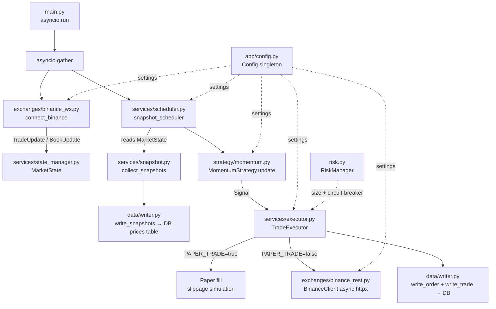

# algo-trade — Implementation Plan

## Problem Statement

Build a production-ready algorithmic trading bot targeting Binance Spot markets (Futures extensible later). It ingests live prices via Binance WebSocket streams, aggregates them into periodic snapshots, runs a momentum strategy on each tick, and executes real orders via the Binance REST API using async httpx. A `PAPER_TRADE` flag (default `true`) simulates slippage-aware fills without touching real money. State is persisted in PostgreSQL via SQLAlchemy async + Alembic.

---

## Requirements

- **Exchange**: Binance Spot (mainnet by default, testnet URL swappable via config)
- **Ingest**: Binance combined WebSocket stream (`@trade` + `@bookTicker`) per symbol; ticks update in-memory `MarketState`
- **Strategy cadence**: Snapshot scheduler (configurable `tick_period`) drives strategy evaluation, not raw ticks
- **Strategy**: Momentum — EMA crossover + RSI + Bollinger Bands + ATR + ROC; signals: BUY / SELL / HOLD (spot only; SHORT/COVER omitted for now, spot doesn't support naked shorts)
- **Execution**: Async `httpx.AsyncClient`, HMAC-SHA256 auth (`X-MBX-APIKEY` header + `signature` query param), clock-sync on init
- **Paper trading**: Slippage-aware synthetic fills, no real API order calls; toggleable via `PAPER_TRADE=true/false`
- **DB**: `prices`, `orders`, `trades`, `equity`, `state` tables; async SQLAlchemy + asyncpg; async Alembic env
- **Config**: Single `app/config.py` pydantic-settings `Config` class, module-level singleton, all tunable params with uppercase env aliases, `PAPER_TRADE=true` default
- **Structure**: Single process, `asyncio.gather` across WS ingest + snapshot scheduler; clean internal module separation
- **Tooling**: `uv`, `ruff`, `ty`, `pytest` + `pytest-asyncio`, full `Makefile`, `.env.example`

---

## Architecture



---

## Module Layout

```
algo-trade/
├── main.py                          # asyncio.run(main())
├── app/
│   ├── config.py                    # Config(BaseSettings) singleton
│   ├── risk.py                      # RiskManager (drawdown + sizing)
│   ├── exchanges/
│   │   ├── __init__.py
│   │   ├── binance_ws.py            # WebSocket ingest
│   │   └── binance_rest.py          # Async httpx Binance REST client
│   ├── services/
│   │   ├── __init__.py
│   │   ├── normalizer.py            # TradeUpdate / BookUpdate dataclasses + parse
│   │   ├── state_manager.py         # MarketState in-memory
│   │   ├── snapshot.py              # collect_snapshots()
│   │   ├── scheduler.py             # snapshot_scheduler() coroutine
│   │   └── executor.py              # TradeExecutor (paper + live dispatch)
│   ├── strategy/
│   │   ├── __init__.py
│   │   └── momentum.py              # Indicators + MomentumStrategy + PairState
│   └── data/
│       ├── engine.py                # Base + async engine + sessionmaker
│       ├── session.py               # get_session() context manager
│       ├── writer.py                # write_snapshots, write_order, write_trade, write_equity
│       ├── queries.py               # DB stateless query class
│       └── models/
│           ├── __init__.py          # imports all models (Alembic registration)
│           ├── prices.py
│           ├── orders.py
│           ├── trades.py
│           ├── equity.py
│           └── state.py
├── alembic/
│   ├── env.py                       # async Alembic env
│   └── versions/
│       └── 0001_initial_schema.py
├── alembic.ini
├── tests/
│   ├── test_normalizer.py
│   ├── test_strategy.py
│   ├── test_risk.py
│   └── test_executor.py
├── Makefile
├── .env.example
├── PLAN.md
└── pyproject.toml
```

---

## Background — Reference Projects

- **fibobase/ingest**: canonical async WebSocket pattern — `connect()` + `async for message`, normalizer dataclasses (`TradeUpdate`/`BookUpdate`), `MarketState` in-memory, `snapshot_scheduler` with drift-correcting `asyncio.sleep`, async SQLAlchemy writer
- **quant-bot**: canonical config pattern (`Config(BaseSettings)`, `Field(alias=...)`, `field_validator`s, singleton), `RiskManager` (drawdown circuit-breaker + volatility-adjusted sizing), `MomentumStrategy` (per-pair `PairState` dataclass, deque price window), httpx client with HMAC auth + clock sync + centralized `_request()`, `DB` stateless query class, Makefile conventions
- **fibobase/exec**: canonical ORM models (`Orders`, `Trades`, `Positions`) with `Numeric(20,8)` precision, `OrderRequest`/`OrderResult`/`OrderSide`/`OrderType` dataclasses and enums

---

## Task Breakdown

### Task 1: Project Foundation — config, pyproject, Makefile, .env.example

**Objective**: Establish the complete config surface and project tooling so every subsequent task has a stable foundation to build on.

- Replace the stub `app/config.py` with a full `Config(BaseSettings)` following quant-bot's pattern: all fields with `Field(alias="UPPER_CASE")`, `SettingsConfigDict(env_file=".env")`, `PAPER_TRADE=true` default, `LIVE_TRADING_ENABLED=false` guard, `field_validator` for `db_url` driver prefix and `symbols` CSV parsing. Include all tunable parameters: exchange URLs, WS base URL, tick period, symbols tuple, max positions, strategy params (EMA periods, RSI, BB, ATR, ROC), risk params (position sizing, drawdown, commission, slippage), and logging config.
- Add `asyncpg>=0.30.0` to `pyproject.toml` dependencies.
- Write a complete `Makefile` following quant-bot conventions: `help` default, `.PHONY`, `sync`, `test`, `migrate`, `migration`, `run`, `lint`, `format`, `type`.
- Write `.env.example` with all required env vars, sensible placeholder values, and inline comments.

**Tests**: Import `Config` and assert `config.paper_trade is True` (default). Assert `config.model_copy(update={"paper_trade": False}).paper_trade is False`.

**Demo**: `make sync` installs all deps cleanly; `uv run python -c "from app.config import config; print(config.paper_trade)"` prints `True`.

---

### Task 2: Async DB Layer — engine, models, session, Alembic

**Objective**: Stand up a fully async SQLAlchemy + Alembic stack with all five tables migrated to the DB.

- Replace `app/data/engine.py` with async engine: `create_async_engine(settings.db_url)`, `async_sessionmaker(class_=AsyncSession)`, `Base(DeclarativeBase)`.
- Fill `app/data/session.py` with an `async def get_session()` async context manager.
- Define all five ORM models:
  - `prices.py`: `(symbol, snapshot_at)` composite PK, `exchange`, `last_price`, `bid_price`, `ask_price` as `Numeric(38,18)`
  - `orders.py`: auto-increment PK, `exchange_order_id UNIQUE`, full order lifecycle fields (`order_type`, `status`, `filled_quantity`, `average_fill_price`, `created_at`, `updated_at`)
  - `trades.py`: auto-increment PK, `exchange_order_id UNIQUE`, `symbol/side/quantity/price/fee` as `Numeric(20,8)`, `executed_at` with index
  - `equity.py`: `snapshot_at TIMESTAMP PK`, `equity Numeric(20,8)`
  - `state.py`: `key TEXT PK`, `value TEXT`
- Write `models/__init__.py` that imports all five models (Alembic registration pattern).
- Configure `alembic.ini` + `alembic/env.py` using the async pattern from fibobase/ingest (`asyncio.run` + `connection.run_sync`, `compare_type=True`).

**Tests**: Smoke test — import all models without error.

**Demo**: `make migrate` runs to completion; all five tables created with correct columns.

---

### Task 3: Binance WebSocket Ingest + Normalizer + MarketState

**Objective**: Stream live Binance market data into in-memory state — the data foundation for strategy evaluation.

- Write `app/services/normalizer.py`: frozen `TradeUpdate` and `BookUpdate` dataclasses, `normalize(payload, exchange)` dispatcher.
- Write `app/services/state_manager.py`: `InstrumentState` dataclass, `MarketState` class with `initialize()`, `apply_change()`, module-level `market_state` singleton.
- Write `app/exchanges/binance_ws.py`: `build_stream_url(symbols)` combining `@trade` and `@bookTicker` streams; `connect_binance(symbols)` async function with reconnection and exponential backoff.

**Tests**: Feed raw Binance-shaped dicts and assert correct `TradeUpdate`/`BookUpdate` field values. Test `MarketState.apply_change()` updates correct instrument state.

**Demo**: WS connector confirms `market_state` for `btcusdt` updates `last_price` within seconds of startup.

---

### Task 4: Snapshot Scheduler + DB Persistence

**Objective**: Persist periodic price snapshots to the DB and wire the scheduler coroutine that drives the bot's clock.

- Write `app/services/snapshot.py`: `collect_snapshots(market_state) -> list[SnapshotRow]` — returns only instruments with non-None prices.
- Write `app/data/writer.py`: `async def write_snapshots(snapshots)` with upsert-on-conflict; `async def write_equity(equity: Decimal)`.
- Write `app/services/scheduler.py`: drift-correcting `asyncio.sleep` loop, calls `collect_snapshots` then `write_snapshots` every `settings.tick_period` seconds.
- Update `main.py` to: initialize `market_state`, `asyncio.gather(connect_binance(symbols), snapshot_scheduler(market_state))`.

**Tests**: `collect_snapshots` returns only priced instruments. Mock `write_snapshots` in async test to assert called with correct data.

**Demo**: After one `tick_period`, the `prices` table has rows.

---

### Task 5: Momentum Strategy + Risk Manager

**Objective**: Implement the full signal-generation layer as a pure, testable, side-effect-free module.

- Write `app/strategy/momentum.py`: indicator functions (`ema`, `rsi`, `bollinger_bands`, `atr`, `rate_of_change`); `PairState` dataclass with `deque(maxlen=300)`; `MomentumStrategy` with `update(symbol, price) -> Signal` (`BUY | SELL | HOLD`), `notify_bought`, `notify_sold`, `restore`, `indicators`.
- Write `app/risk.py`: `RiskManager` — `update_equity`, `size_usd` (conviction + volatility-adjusted, drawdown circuit-breaker), `quantity` (floor to precision).

**Tests**: Hard stop-loss, take-profit, trailing stop, warmup guard, EMA crossover BUY, stagnant exit. Drawdown halts trading, sizing respects `max_position_pct`, zero result on zero equity.

**Demo**: Feed synthetic price series into `MomentumStrategy`, get a non-HOLD signal.

---

### Task 6: Binance REST Client + DB Query Layer

**Objective**: Build the async Binance API client and the full DB query class.

- Write `app/exchanges/binance_rest.py`: `BinanceClient` with `httpx.AsyncClient`, HMAC-SHA256 signing, clock-sync on init, centralized `_request()`. Methods: `ping()`, `get_exchange_info()`, `get_account()`, `get_ticker()`, `place_order()`, `cancel_order()`, `query_order()`, `close()`.
- Write `app/data/queries.py`: `DB` stateless async query class — `get_state`, `set_state`, `set_multiple_states`, `get_prices`, `get_recent_prices_bulk`, `insert_order`, `update_order_status`, `insert_trade`, `insert_equity`.

**Tests**: Mock `httpx.AsyncClient`; assert `place_order` sends correct signed params; assert clock offset applied; assert `_request` raises on non-2xx.

**Demo**: Testnet `await client.ping()` returns server time.

---

### Task 7: Trade Executor — Paper and Live Dispatch

**Objective**: Wire strategy signals to order execution, implementing both paper-trading and live paths.

- Write `app/services/executor.py`: `TradeExecutor` class. Core `async def process_tick(symbol, snapshot)`: get price → call strategy → dispatch SELL/BUY → persist via DB.
- Paper path: synthetic `exchange_order_id`, apply `slippage_bps` to fill price.
- Live path: call `client.place_order(...)`, parse Binance response.
- Plug into `scheduler.py`: after `write_snapshots`, iterate symbols, call `executor.process_tick`. Write equity snapshot after all ticks.

**Tests**: Paper BUY inserts correct synthetic fill; SELL removes position from state; circuit-breaker halts buys; slippage applied correctly.

**Demo**: Paper mode — after BUY signal fires, `orders` and `trades` tables have rows; `state` has `bot_positions`.

---

### Task 8: State Restore, Session Management, Graceful Shutdown

**Objective**: Make the bot production-ready — survive restarts, handle signals cleanly, log comprehensively.

- Add startup restore in `main.py`: load `bot_positions` from state KV → `strategy.notify_bought`; bulk-fetch price history → `strategy.restore`; init `RiskManager` from last equity row.
- Add graceful shutdown: `signal.signal(SIGINT/SIGTERM, stop)` sets `running` flag; scheduler checks it; `BinanceClient.close()` in `finally`.
- Add `_configure_logging()`: `StreamHandler` + `FileHandler`, INFO level.
- Add `config.validate_live_execution()`: raises `RuntimeError` if `PAPER_TRADE=false` and credentials not set.

**Tests**: `validate_live_execution` raises without credentials. After `notify_bought` + `restore`, first `strategy.update` returns `HOLD`.

**Demo**: Start → Ctrl-C → restart → bot logs "Restored N positions, warmed up M symbols" and resumes without re-buying held positions.
